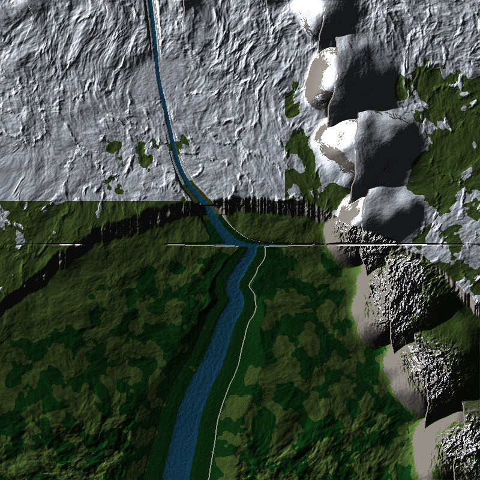

# AETHER · 程序化荒野

**10.24 km² 纯程序化自然地形 · Godot 4.7.2 · 零外部美术资产**

一张 3.2 km × 3.2 km 的高地：西北是雪原台地，中央是 200 m 瀑布与环形悬崖，
南面是热带雨林盆地，一条河从雪原穿过悬崖、峡谷和雨林。全程用几何体拼接、
参数化曲面和纯数式着色器生成，没有模型、贴图或 HDRI 资产。


---

## 1. 三种地形

| 地貌 | 位置 | 高度 | 做法 |
| --- | --- | --- | --- |
| **雪原** | 西北 `-Z` 台地 | 500–700 m | 抬升的雪原掩膜 + 风蚀脊（sastrugi）+ 雪线噪声；雪面着色器带蓝影、风纹和高光颗粒 |
| **热带雨林** | 南侧盆地 `+Z` | 20–330 m | 暖湿掩膜 + 分层树冠；8.8k 棵程序化树、4 万个草簇、9.5k 株蕨、1.7k 丛芦苇；树冠用连续 canopy carpet 与近景 leaf-card 树混合 |
| **山地悬崖 + 河谷** | 中央 `z≈-200` | 290–1050 m | 东北向花岗岩山墙（解析山峰 + smooth-max）+ 环形断崖 + 200 m 瀑布 + 河流峡谷；河流由样条雕刻，瀑布下方是跌水潭 |

整张地图三面被山包围，南侧向海/云海打开；黄昏时太阳落在山脊后，谷地形成
体积雾和逆光。



> 上图为 `tools/preview_map.gd` 生成的地形/生态分布图，北在上。

---

## 2. 纯程序化管线

### 2.1 高度场（`scripts/terrain_field.gd`）

- 域扭曲（domain warp）+ 多层 simplex fBm、ridged multifractal；
- 用解析高斯山峰链、`smoothmax` 和雪原平台掩膜拼出主山体，而不是单纯叠噪声；
- 河流中心线是手工 Catmull-Rom 样条，沿 `z` 采样；河流距离用切线法线近似；
- 河谷用幂函数剖面下切，瀑布处只开一条窄槽，保持两侧悬崖完整；
- 山顶、悬崖、雨林地面、雪原各自有独立的高频/低频细节项；
- 所有参数由种子 `20261115` 决定，可复现。

### 2.2 地形网格（`scripts/terrain_builder.gd`）

- 1024 × 1024 高度网格，8 × 8 个 chunk，共享边界顶点，无裂缝；
- 法线由中心差分生成；
- 每个顶点写入一个“湿度/近水”属性，供着色器做湿石、河床和雪线变化；
- 总共约 209 万三角形，64 个 draw call。

### 2.3 水文（`scripts/water_builder.gd`）

- 河面是从同一条样条扫出的参数化 ribbon（宽度 30–128 m），UV 沿流向；
- 瀑布是 44 × 12 的参数化水幕，顶部有溢流池，底部有跌水潭；
- 水面着色器：屏幕空间深度折射、屏幕空间反射、双层流动噪声、岸边泡沫、太阳高光；
- 瀑布着色器：竖向流动条纹、边缘羽化、底部水雾粒子（GPUParticles3D）。

### 2.4 植被（`scripts/tree_builder.gd`、`forest_builder.gd`、`ground_cover.gd`）

- 6 种树原型：巨树、阔叶树、棕榈、林下树、针叶树、远景树冠；
- 树干/树枝是扫掠管（参数化曲面），树冠是椭圆壳 + 30 张 leaf card / 簇；
- leaf card 的 alpha 图案完全由 shader 计算，并用 alpha scissor 投射阴影；
- 远景树冠使用低模椭球团 + 连续 canopy carpet，近景（四个观察中心）使用 leaf-card 树；
- 草/蕨/芦苇/灌木都是临时生成的 MultiMesh，带风摆 shader；
- 实例按 400–800 m 的 cell 分组，便于视锥剔除。

### 2.5 岩石（`scripts/rock_builder.gd`）

- 河床卵石、山脚岩块、悬崖石柱；
- 卵石是噪声位移的 UV 球，按面法线/径向法线着色；
- 石柱是锥形扫掠体，带噪声起伏；
- 岩石着色器叠加大尺度色差、节理、苔藓、雪帽和法线凹凸。

### 2.6 纹理 / 着色器（`shaders/`）

全部贴图都是 shader 里的数学函数，没有 PNG：

- `terrain.gdshader`：高度/坡度/朝向掩膜，rock/snow/forest/meadow/wet 混合；
  程序化岩石节理与雪面风纹；屏幕空间法线扰动；湿河床变暗；
- `water.gdshader`、`waterfall.gdshader`：水色、折射、反射、泡沫、流动；
- `sky.gdshader`：渐变大气、太阳盘/光晕、2 层 fBm 云、月亮和星空方向；
- `leaves.gdshader`、`palm_frond.gdshader`、`needles.gdshader`、`bark.gdshader`：
  叶片/棕榈/针叶/树皮的 alpha 与颜色，带风摆和逆光；
- `grass.gdshader`、`fern.gdshader`、`canopy.gdshader`、`foliage_far.gdshader`：
  林下植被与远景树冠；
- `rock.gdshader`、`distant.gdshader`：岩石与远景山脉；
- `mist.gdshader`：瀑布水雾的软粒子。

### 2.7 大气（`scripts/atmosphere.gd`）

- 4 个 `FogVolume`，密度纹理是运行时生成的 3D 噪声；
- 2 个瀑布水雾 emitter；
- 全局 volumetric fog + 高度雾 + 空气透视；
- 天空/太阳/月亮由天空 shader 与 DirectionalLight3D 驱动。

### 2.8 远景

- `scripts/backdrop.gd` 生成不可游玩的远景山脊环，隐藏 10.24 km² 的边界；
- 天空地面的“海/云海”是天空 shader 的低空色，不是可游泳的水面；
- 地图本身严格为 3.2 km × 3.2 km。

---

## 3. 规模

| 项目 | 数值 |
| --- | --- |
| 地图 | 3.2 × 3.2 km = **10.24 km²** |
| 高度范围 | ≈14 m – 1003 m |
| 瀑布落差 | ≈ 207 m |
| 地形网格 | 1024²，64 chunks，≈ 2.09 M triangles |
| 程序化树 | 8.8 k 棵（含远景 LOD） |
| 草 / 蕨 / 芦苇 / 灌木 | 39.9 k / 9.5 k / 1.7 k / 0.4 k |
| 河石 + 山脚岩块 + 石柱 | ≈ 2.5 k + 34 |
| 雾体积 / 水雾 emitter | 4 / 2 |
| 外部贴图 / 模型 | **0** |

---

## 4. 运行

```bash
# 在本目录执行（脚本自行 cd 到工程根，随仓库迁移不影响）

# 交互式（默认 768 网格）
./run.sh

# 生成 1600×900 截图（1024 网格，约 30 s 构建 + 每张 30 帧）
./capture.sh
```

需要 Godot 4.7.2 和显示服务器：

```bash
DISPLAY=:0 godot --path . -- --shot=hero_dusk,snow_edge,forest,gorge,river,panorama --res=1024
```

`--res=512/768/1024` 控制地形分辨率；截图通过 1600×900 的 SubViewport
离屏渲染，因此不会被桌面缩放影响。

### 操作

- `WASD` 平移，鼠标转向，`Q/E` 下降/上升，`Shift` 加速
- `1` 黄昏主视角，`2` 雪原边缘，`3` 雨林树冠，`4` 峡谷，`5` 瀑布，`6` 雪原清晨，`7` 全景，`8` 日间
- `H` 开关 HUD，`Esc` 释放/捕获鼠标

---

## 5. 截图

| 文件 | 内容 |
| --- | --- |
| `screenshots/hero_dusk.png` | 黄昏逆光：雪原台地、200 m 瀑布、峡谷、雨林树冠和东侧山墙 |
| `screenshots/snow_edge.png` | 雪原边缘俯视雨林与远处海/云海；雪脊、高山草甸、瀑布源头 |
| `screenshots/forest.png` | 雨林树冠航拍：连续树冠、河流、悬崖 |
| `screenshots/gorge.png` | 峡谷西侧：瀑布、悬崖、雨林与河谷 |
| `screenshots/river.png` | 沿河航拍：雨林树冠夹着河道，远处是悬崖 |
| `screenshots/panorama.png` | 10.24 km² 全景：雪原、山墙、雨林、海/云海地平线 |

---

## 6. 文件结构

```
project.godot              Godot 4.7 工程
main.tscn                  入口场景
scripts/
  main.gd                  场景装配、环境/灯光、镜头、截图
  terrain_field.gd         高度场/河流/生态数学
  terrain_builder.gd       分块地形网格
  water_builder.gd         河面/瀑布/水潭
  tree_builder.gd          树原型（管状枝干 + leaf card）
  forest_builder.gd        林木散布与 LOD
  canopy_carpet.gd         连续雨林树冠
  ground_cover.gd          草/蕨/芦苇/灌木
  rock_builder.gd          卵石/石柱
  atmosphere.gd            雾体积/水雾
  backdrop.gd              远景山脊环
  fly_camera.gd            交互飞行相机 + HUD
shaders/                   15 个纯数式着色器
screenshots/               6 张 1600×900 成片
docs/map_preview.png       地形/生态分布图
tools/preview_map.gd       CPU 地图预览
```

---

## 7. 已知边界

- 地形是高度场，悬崖是“陡坡”而不是真正的垂直/悬垂几何；瀑布口、石柱、
  树冠等是额外的参数化网格。
- 近景树叶是 billboard/leaf-card 簇，目的是在高密度森林里保持可运行；
  它不是逐叶建模，近看会呈现风格化的叶片块。
- 地形是固定 1024² 单块，没有 LOD/流式加载；1024 构建约 30 s。
- 没有碰撞/物理，相机是自由飞行。
- 地图外的远景环和天空“海/云海”是背景，不属于 10.24 km² 可游玩范围。
- 场景风格是“电影化自然主义 + 奇幻黄昏”，不是照片级扫描；所有材质和形状
  都由代码生成，没有外部扫描资产。