# NEON SPRAWL · 霓虹都市

一座 **10.24 km²**（3.2 km × 3.2 km）的赛博朋克城市，完全由 Godot 4.7.2 的 GDScript 在运行时以
**几何体拼接 + 参数化曲面 + 纯数学公式纹理** 程序化生成。没有任何外部美术资源：没有贴图、没有模型、
没有 HDR 环境图，所有材质都由手写 shader 在片元阶段用数学函数求值。

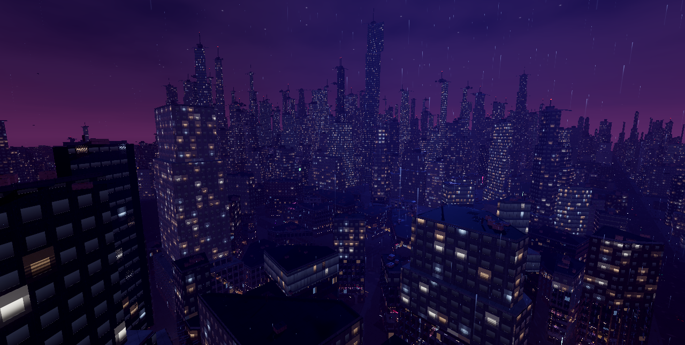
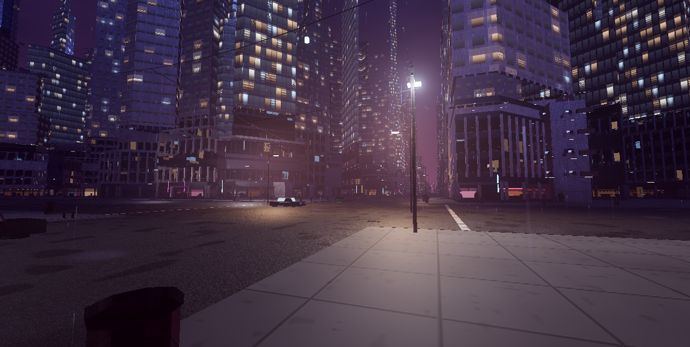
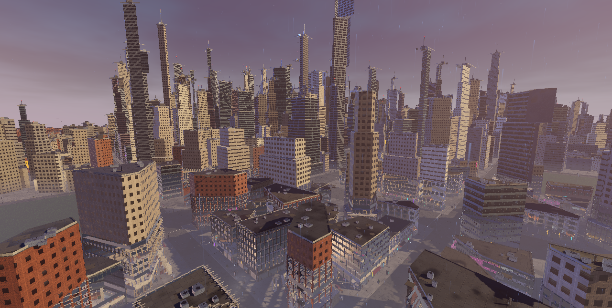
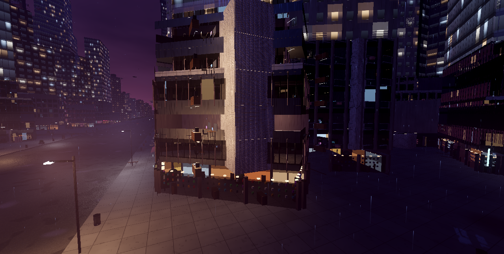
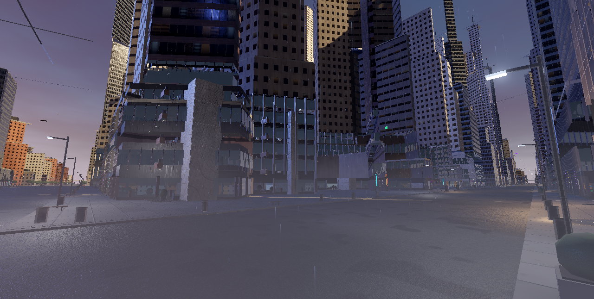
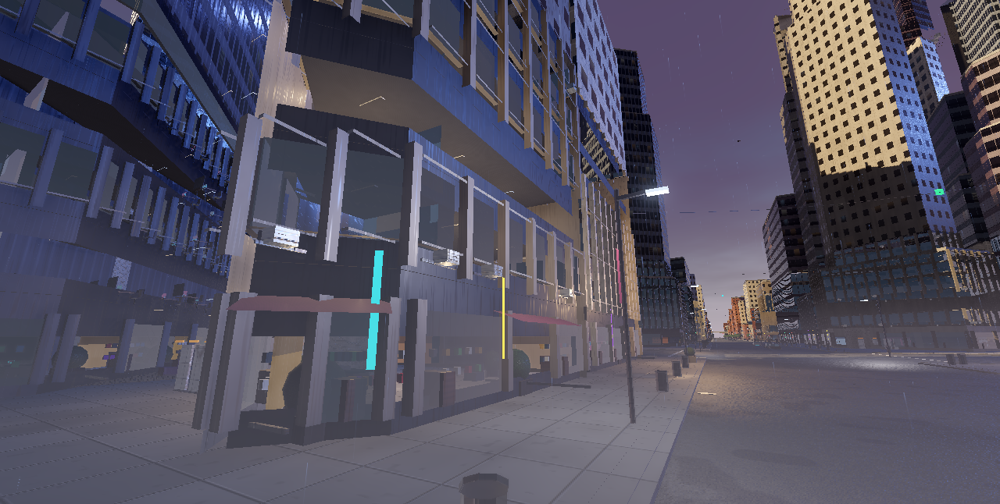

### 地标
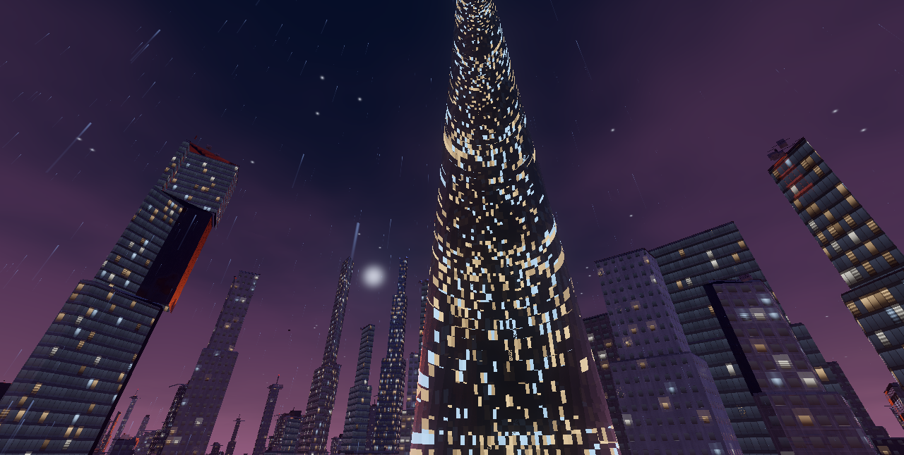
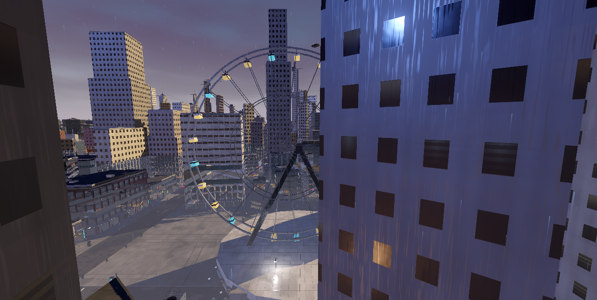
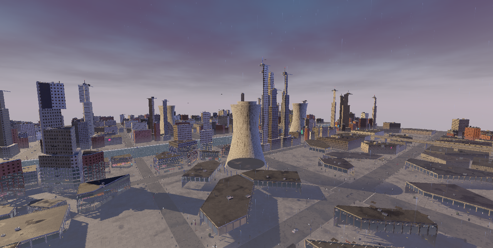
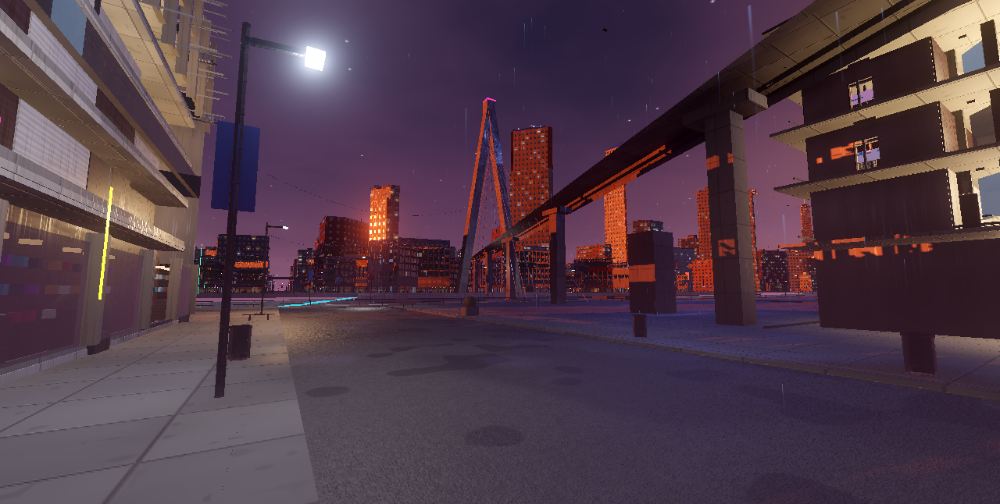
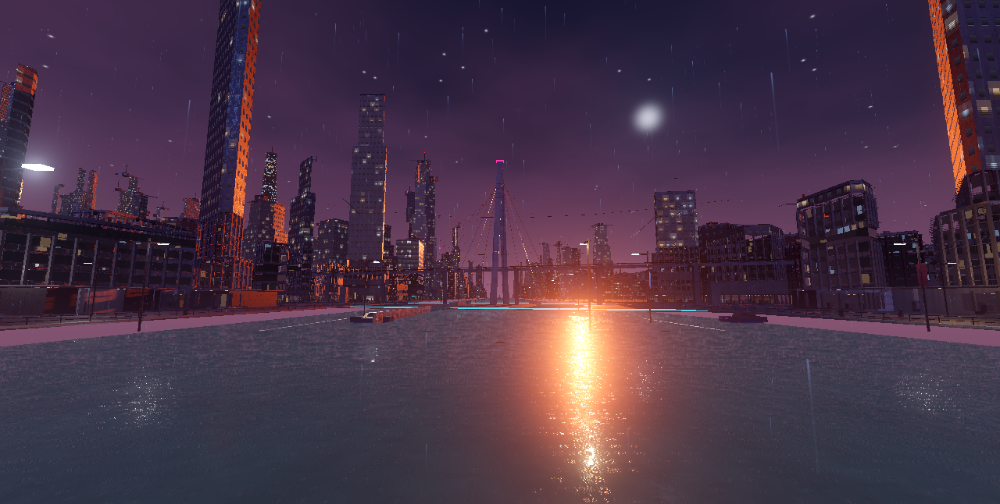

### 室内
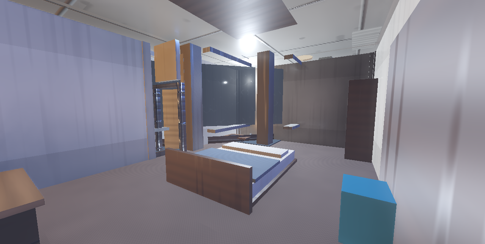
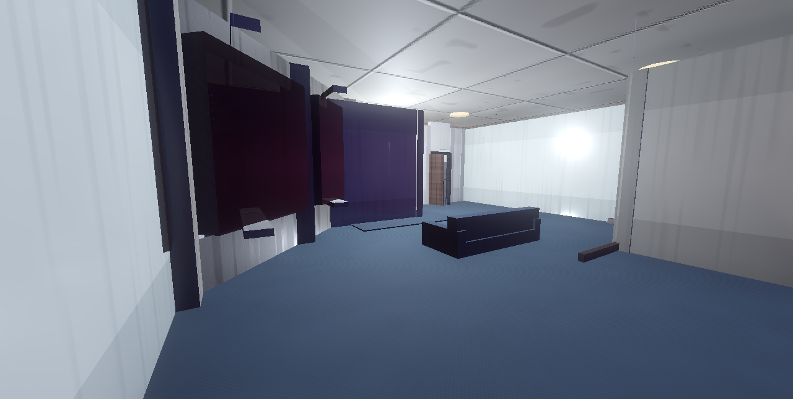
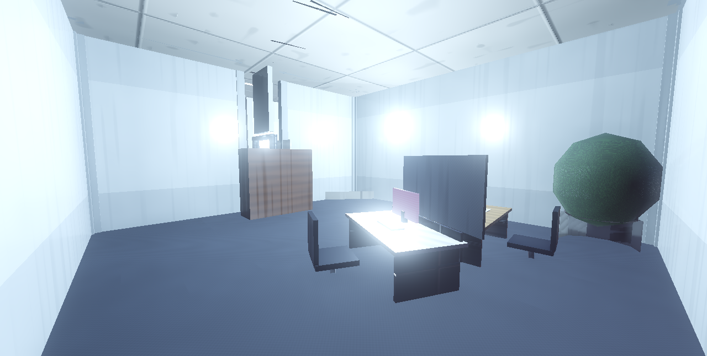
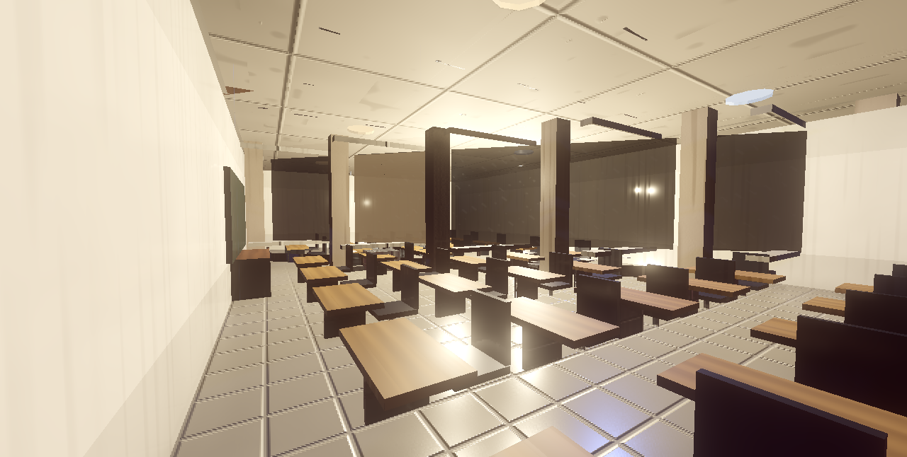

---

## 1. 运行

```bash
cd t1_city/ds41-1017-max
DISPLAY=:0 godot --path .
```

- 引擎：Godot **4.7.2**（Forward+ / Vulkan），本机 GTX 1650 实测 1280×646 约 **48–55 FPS**（垂直同步关闭）。
- 启动约 **1.5–3 s**（含规划 0.4 s、地面 0.7 s、全城远景壳体 0.5 s；首次运行需编译 shader 会略慢），随后建筑细节按距离流式生成。
- 首次运行若提示缺少全局类，执行一次 `godot --headless --import` 即可。

### 操作

| 键 | 功能 |
| --- | --- |
| `W A S D` + 鼠标 | 自由飞行（点击窗口锁定鼠标，`Esc` 释放） |
| `Shift` / `Q` `E` | 加速 / 升降 |
| `T` | 昼夜循环：night → dusk → day → storm |
| `R` | 雨量切换（同时改变湿润度、反射、雾） |
| `X` | X-Ray：透视最近的一栋楼，实时生成该楼全部楼层的室内 |
| `G` | 与 `X` 相同的剖面检视 |
| `5` | 传送到最近建筑内部（大堂） |
| `1`–`4` | 相机预设：街景 / 空中 / 运河 / 塔顶 |
| `F` | 隐藏 HUD |
| `H` | 隐藏/显示 HUD（main 层） |

### 截图 / 基准测试

```bash
# 任意相机位置截图
DISPLAY=:0 godot --path . -- --shot=x --out=res://shots/x.png --frames=140 \
    --campos=600,90,600 --camlook=200,10,200 [--preset=day] [--vol=0]

# 性能采样（200 帧后打印 draws / prims / fps）
DISPLAY=:0 godot --path . -- --bench=1

# 指定种子重建整座城市
DISPLAY=:0 godot --path . -- --seed=2026
```

---

## 2. 需求对照

| 要求 | 实现 |
| --- | --- |
| 10 km² 现实尺度 | 3 200 m × 3 200 m 路网，全部尺寸以米为单位（车道 3.5 m、层高 3.2–4.2 m、路宽 13/21/34 m） |
| 建筑有内部细节 | 每栋近景建筑按楼层生成：楼板/吊顶/核心筒/电梯/楼梯/隔墙/门洞 + 按功能配置的家具（办公工位、公寓卧室/厨房/卫浴、酒店客房、商铺货架、教室、仓库货架、地下车库） |
| 道路布局合理 | 21×21 条街道的干道网格（每 640 m 一条 34 m 主干道）+ 对角林荫大道 + 运河 + 高架环路；带车道线、斑马线、停止线、人行道、路缘、路灯、红绿灯、井盖、绿化 |
| 居民区/学校/商区 | 8 类分区（CBD / 商业 / 住宅 / 校园 / 工业 / 滨水 / 混合 / 公园），按高斯场 + 噪声分配地块，建筑类型与高度分布随分区变化 |
| 纯程序化建模 | 无任何导入资产。`MB` 网格构建器提供棱柱/挤出/扫掠/旋转体/管道/圆环等参数化曲面；路面、幕墙、家具均为运行时生成 |
| 数学公式纹理 | 单个 uber shader 用 fbm/hash/voronoi/导数凹凸等函数实时生成砖、混凝土、玻璃、金属、木材、瓷砖、沥青、霓虹、广告屏、树叶等 16 种材质；天空、水、雨也全部是 shader |
| 写实风 | 真实尺度、逐层退台、窗洞凹进、窗台/檐口/阳台/栏杆、屋顶设备（空调机组/水箱/天线/楼梯间）、底层商铺橱窗、污渍/雨痕/水洼/湿润反射、SSAO/SSR/体积雾/ACES |
| 科幻 + 赛博朋克 | 霓虹灯牌、全息广告屏、无人机航道、高架环线、悬浮车灯、扫描线广告、雨夜紫红雾霾、冷蓝/暖橙对比 |

---

## 3. 系统架构

```
src/
  core/
    mb.gd         网格构建器：所有几何体的底座（顶点/法线/UV/材质参数打包 + 双表面提交）
    m.gd          16 种材质的枚举（与 shader 常量一一对应）
    h.gd          确定性哈希 / 随机数（由坐标与逻辑 id 派生，保证流式重建可复现）
    mats.gd       共享材质（1 个不透明 uber + 1 个玻璃）
  city/
    poly.gd       凸多边形工具：偏移(inset)、半平面裁剪、二分、面积/重心/外接盒
    plan.gd       城市规划：路网 / 运河 / 对角大道 / 分区 / 地块细分 / 建筑任务单
    ground.gd     路面、街区台地、路缘、运河河岸与码头、桥梁、车道线/斑马线/停止线
    build.gd      建筑生成：远景/中景/近景三级；退台体量、幕墙语法、屋顶设备、霓虹
    interior.gd   室内生成：逐层平面（核心筒/电梯/楼梯/卫生间/设备间/管井/走廊/房间）、
                  家具与灯具、按层生成单元
    landmarks.gd  地标：扭转塔、双曲冷却塔、摩天轮、天际铁路、扇面索斜拉桥
    props.gd      街道家具：路灯、行道树、垃圾桶、长椅、报刊亭、售货机、花箱、电缆、红绿灯
    traffic.gd    车流（1 100 辆）、高空无人机（120 架）、行人（700 个）
    infra.gd      高架环线：扫掠桥面、桥墩、护栏、灯柱、霓虹底光
  game/
    env.gd        大气：程序化天空、雾、体积雾、SSAO/SSR、泛光、ACES、昼夜/雨量预设
    fx.gd         GPU 雨幕
    world.gd      世界装配与三档 LOD 流式加载、灯光池、室内调度、X-Ray、截图/基准
    player.gd     自由飞行相机
gfx/
  surface.gdshader  不透明 uber 材质（16 种材质 + 程序化立面窗格）
  glass.gdshader    玻璃（逐窗随机室内灯、雨膜、菲涅尔）
  water.gdshader    运河水体（双频波纹 + 雨点涟漪 + 反射）
  sky.gdshader      天空（霾/云/星/月/城市辉光）
  rain.gdshader     雨丝
tools/
  plan_map.gd     规划平面图渲染（调试用）
  bench_far.gd    远景壳体力生成基准
```

### 3.1 城市规划（`plan.gd`）

1. **路网**：21 条纵向 + 21 条横向道路，位置做 ±4.5 m 抖动；每 4 条为 34 m 主干道，其余 21 m / 13 m。
   另加一条 40 m 宽对角大道和一条 96 m 宽直运河（两侧岸线）。
2. **街区**：相邻道路之间扣除路幅得到 400 个街区矩形，被对角大道与运河裁成凸多边形。
3. **地块**：对每个街区多边形做**递归二分**（沿最长边方向、按 40–60% 比例、可带 ±12° 倾角），
   直到尺寸落入分区目标区间；CBD 30–64 m、住宅 26–44 m、工业 46–100 m、校园整块。
4. **建筑任务单**（6 000+ 条）：按分区抽样建筑类型、层数、立面语法、体量退台、招牌方案、
   少量地标塔（手工指定 6 个位置 + 高度 ≥ 210 m）。

### 3.2 建筑语法（`build.gd`）

- **体量**：`sections()` 生成 1–3 段退台（裙房 + 塔身 + 冠部），每段一个多边形与高度区间。
- **立面**：按开间（1.1–4.2 m，随建筑种子变化）与层高（3.2–4.2 m）逐层生成：窗下墙、窗上墙、
  窗洞侧壁（凹进 0.26 m）、窗台、窗楣、竖梃；每 5 层左右随机插入"实墙层"或"带形窗层"打破网格感。
  六种立面语法各自成形：帷幕墙（通高玻璃 + 层间金属带 + 细竖梃）、行列窗（深窗洞 + 出挑窗台/窗楣）、
  带形窗（水平长窗 + 上下实墙）、竖向遮阳板（深竖肋 + 板后阴影）、金属板（分缝 + 挂板）、工业压型钢板
  （波纹 + 高窗）。并叠加外挂空调机/冷媒管、消防楼梯（平台 + 栏杆 + 之字形梯段）、卷帘门、
  窗台雨痕与污渍等"不完美"细节。
- **底层**：商铺橱窗 + 竖向霓虹灯牌 + 遮阳篷 + 灯光货架 + 收银台；办公/住宅入口门斗、雨棚、壁灯。
- **屋顶**：女儿墙、砾石/防水卷材、空调机组（带风扇盘）、水箱、楼梯间、天线与航空障碍灯、直升机坪。
- **立面材质**：帷幕墙 / 竖向遮阳板 / 带形窗 / 金属板 / 砖 / 混凝土 / 工业压型钢板，颜色与窗墙比随种子变化。

### 3.3 材质：一个 uber shader + 参数化顶点

每个顶点携带 `CUSTOM0 = (材质 id, 样式, 种子, 自发光强度)`，`UV` 是以米为单位的表面坐标，
`COLOR` 是线性空间色调。片元着色器按材质 id 分派到不同的数学纹理：

- 砖：`brick = uv/vec2(0.24, 0.075)`，行错位 + 随机砖色 + 灰缝；
- 混凝土：板缝 + 污渍 fbm + 水洼；
- 沥青：骨料噪声 + 补丁 + 裂缝 + 水洼雨滴涟漪（`sin((r - t) * 42)`）+ 湿润度反射；
- 金属：拉丝 + 锈斑 + 铆接板缝；
- 瓷砖：网格 + 灰缝 + 每砖色差；
- 玻璃：逐窗哈希亮度/色温/百叶，凹进遮光；
- 广告屏：伪汉字笔画（3 条随机横竖笔画组合）+ 扫描线 + 扫光；
- 霓虹：脉冲 + 随机闪烁；
- 树叶/土壤/橡胶/陶瓷/塑料/木纹/织物同理。

立面的窗格也可以完全由 shader 画（远景 LOD）：`facade_windows()` 用 `uv` 米坐标切分
开间×层高，逐窗哈希决定"亮/暗/色温/百叶/电视闪烁"，亮窗顶部更亮以模拟天花灯，窗框带凹进阴影。

### 3.4 地标构筑物（`landmarks.gd`）

全部参数化曲面，融入既有地块（先占位、再清出广场）：

| 构筑物 | 做法 |
| --- | --- |
| **扭转塔** | 36 边 × 逐层截面（半径按 `pow(t,0.82)` 收分，总扭转 124°），玻璃幕墙 + 每 4 层一道金属环带 + 26 条随楼体扭转的竖梃 + 顶冠/尖塔/航空障碍灯，380 m |
| **双曲冷却塔** | 用 `r(y)=r_throat·sqrt(1+((y-y_throat)/a)²)` 生成母线再 `revolve()` 成壳体，配 24 条 V 形支腿、顶部加强环、检修平台；4 座布置在工业区 |
| **摩天轮** | 独立动态节点：双环 + 48 根辐条 + 24 个吊舱（自发光）+ A 形支架 + 站台，绕轴缓慢旋转；地块被清成广场 |
| **天际铁路** | 沿对角大道上方 16 m 的平滑样条，扫掠箱形轨道梁（含侧翼缘与走行轨），桥墩每 34 m，3 座车站，3 节列车循环运行 |
| **扇面索斜拉桥** | 跨运河处：A 形桥塔（62 m）+ 两侧各 9 根呈扇形展开的拉索 + 桥面/护栏/桥台 + 霓虹底光 |

### 3.5 室内（`interior.gd`）

按建筑功能生成**逐层平面**（不是盒子堆）：

- **核心筒**：楼梯（真实踏步）、2 部电梯井与电梯门、卫生间（隔间/洗手台/镜子）、设备间、管道井（立管）。
- **交通**：每层一条走廊（位置随长轴旋转），房间沿走廊排布并带门洞、门框与半开的门。
- **办公**：开敞办公 + 独立办公室网格 + 会议室（桌椅/屏幕/白板/咖啡杯）+ 茶水间 + 服务器间。
- **公寓**：每层 2–6 户，户内再切出起居/卧室/厨房/卫生间，带床、沙发、茶几、电视、衣柜、橱柜、冰箱、灶台、淋浴、绿植、地毯。
- **酒店**：走廊 + 客房（床/床头柜/行李/电视/卫浴），另设布草间。
- **学校**：走廊 + 教室（课桌阵列/黑板/讲台/纸页）+ 实验室 + 教师办公室。
- **商业**：货架阵列 + 商品 + 收银台；**仓库**：三层货架 + 托盘 + 叉车；**车库**：车位线与停放车辆。
- 每间房独立饰面：乳胶漆（缎面）/ 壁纸 / 墙砖 / 木饰面 / 软包，按房间类型分配；墙面分
  地脚、主面、天花三段做 AO 明暗，阴阳角额外加压暗条；地面按房间铺地毯/木地板/瓷砖/混凝土；
  踢脚线、门套、天花线脚、灯位齐备。
- 瓷砖地面/墙砖改为 0.45 m 大格 + 柔和缝线 + 屏幕足迹衰减（`fwidth`），远距离不再产生摩尔纹。
- 家具按真实尺度：床 2.0×1.5 m、床面 0.55 m（床架 0.35 m + 床垫 0.20 m），工位桌高 0.75 m、
  桌板 40 mm，椅座 0.45 m，沙发座高 0.40 m，茶几 0.40 m。
- 桌面文件、咖啡杯、打开的笔记本、歪斜的椅子等“生活痕迹”由房间种子随机产生。
- 光照：室内点光按建筑类型分配色温（住宅 2700K 暖、办公 5000K 冷、学校中性），白天窗光偏冷、
  室内灯偏暖，形成冷暖对比；墙面自发光压到 0.055 以免填平暗部。

**流式与预算**：室内按「每层一个作业」入队，主线程每帧只处理 ≤3 ms / ≤4 层，
生成后作为独立节点挂到该建筑的室内容器下；相机高度 ±3 层与地面层按需生成，
`X` 键对最近建筑生成最多 25 层并透视剖切。启动只预生成远景壳体，不阻塞首帧。

按建筑功能生成楼层平面：

- **公寓**：长轴走廊 + 两侧套间，套间内再切出卧室/卫浴/起居+开放厨房（床、衣柜、床头灯、沙发、
  茶几、电视、灶台、冰箱、淋浴、马桶、洗手台、绿植、地毯、书架、餐桌椅）；
- **办公/塔楼**：核心筒 + 开放办公区（工位阵列：桌板/桌腿/显示器/椅/隔断）+ 玻璃会议室 + 茶水间；
- **酒店**：走廊 + 客房（床、床头柜、电视、卫浴）；
- **商铺/商场**：货架排 + 商品 + 收银台；
- **学校**：走廊 + 教室（课桌阵列、黑板、讲台）；
- **仓库**：三层货架 + 托盘货物 + 叉车；
- **车库**：车位线 + 停放车辆。

室内按"相机所在楼层 ±3 层"生成（近处建筑），或用 `X` 键对最近建筑生成全部楼层并开启透视。

### 3.5 三档 LOD 与流式加载

| 档位 | 半径 | 内容 | 数据结构 |
| --- | --- | --- | --- |
| 远景 | 全城 | 每栋 1 个挤出棱柱 + 屋顶块，立面窗由 shader 绘制 | 每 160 m 分块合并，400 个 `MeshInstance3D` |
| 中景 | ≤ 980 m | 完整退台体量 + 女儿墙 + 屋顶设备 + 招牌 + 街道家具/电缆/红绿灯 | 每街区合并 1 个网格 |
| 近景 | ≤ 300 m | 逐栋独立节点：真实窗洞、底层商铺、阳台、屋顶设备；可按栋设置透明（X-Ray） | 每栋 1 个网格 |
| 室内 | ≤ 70 m | 楼层平面 + 家具 + 灯具 | 每栋 1 个网格，随相机楼层重建 |

远景壳体在启动时一次性生成（0.5 s / 400 块 / 10 万三角形），中近景在相机移动时按块/按栋增量构建。

### 3.6 交通 / 街道生命

- **车流** 1 100 辆（20 Hz 更新）：沿 23 条主干道 + 高架环线行驶，车道偏移 ±2.3 m，双向，逐帧更新 MultiMesh 变换；
  车体为程序化低多边形（车身/引擎盖/后备箱/带倾角座舱/前后窗/车灯/轮毂/底盘氛围灯）。
- **无人机** 120 架：不同半径、高度 35–190 m 的环形航道，带闪烁航行灯。
- **行人** 520 个：沿街区边缘人行道往返，带行走起伏。
- **街道**：路灯（就近 36 盏真实 OmniLight + 所有灯头自发光）、跨街电缆、悬挂灯串、
  红绿灯、报刊亭、售货机、花箱、垃圾桶、长椅、行道树、店面霓虹刀牌、卷帘门。
- **地面**：2.2 m 混凝土板缝 + 逐板色差 + 裂纹/口香糖污渍、45° 倒角路缘 + 路缘污垢带、
  沥青骨料/补丁/裂缝/水洼、车辆轮迹磨痕带、雨水篦子、井盖。

### 3.7 大气与后处理

- 自定义天空 shader：高度渐变 + 云层 fbm + 星空 + 月盘 + 地平线城市辉光 + 霾；
- 指数高度雾 + 体积雾（夜间带品红自发光）+ 泛光 + Filmic 色调映射 + 对比度/饱和度调色；
- 冷暖分离：暖色主平行光 + 冷色反向补光（day/dusk 时启用），阴影侧偏蓝、阳光侧偏金；
- SSAO（半径 2.2 / 强度 3.4 / light_affect 0.42，压暗街谷基部）+ SSR（湿路面/玻璃/水面反射）
  + 4 级阴影 + 雨幕粒子；
- 玻璃：金属度 0.55（日）/0.92（夜）、粗糙度 0.10（日）/0.045（夜）分离，白天靠高光反射、
  夜间靠室内自发光，避免"塑料幕墙"。

---

## 4. 性能

| 场景 | 分辨率 | FPS | draw calls | primitives |
| --- | --- | --- | --- | --- |
| 街景（近景 + 中景 + 全城远景） | 1280×646 | ~52 | 566 | 3.9 M |
| 天际线（中景为主） | 1280×646 | ~55 | 545 | 3.6 M |
| 白天俯瞰 | 1280×646 | ~42 | 620 | 4.3 M |

> 数字来自 `--bench=1`（关闭垂直同步）。1080p 下约下降 30–40%。所有几何体在启动时程序化生成，
> 运行期无磁盘 IO。

规模统计（默认种子 1337）：

- 建筑 **6 221** 栋（含 5 座地标构筑物），地块 **7 000+**，街区 440 个（含运河/对角大道切割）
- 道路 43 条（含对角大道），高架环线周长约 10 km，桥 2 座
- 远景三角形约 10 万；整城（含近景/室内/道具/交通）峰值约 500 万（含阴影 pass）

---

## 5. 可复现性与参数

城市完全由 `--seed` 决定（默认 1337）。所有随机数都来自 `H.rng(x, y, id)` 的空间/逻辑哈希，
因此流式加载的每一块都可在任意时刻重建为相同内容。

可调参数集中在：

- `CityPlan`：`HALF`（城市半径）、`CELL`（街区尺寸）、`river_w`、道路宽度函数、分区高斯场；
- `Builder`：层高、开间、退台规则、屋顶设备密度；
- `World`：`MID_RADIUS` / `FULL_RADIUS`、灯光池大小；
- `Env.PRESETS`：昼夜/雨量/雾/泛光参数。

---

## 6. 已知限制

- 立面细节在 26 m 以上改为 shader 窗格（无几何凹进），远看一致、近看略平；这是为 10 km² 规模做的取舍。
- 室内仅在相机附近生成；X-Ray 模式对单栋建筑生成最多 25 层。
- 建筑内部与室外的过渡使用 0.42 m 内衬墙，窗洞与幕墙开间对齐到 0.1 m 量级，可能存在微小错位。
- 汽车为约 200 三角形的程序化模型，近距离细节有限。
- 交通不包含路口信号灯博弈与碰撞避让（车辆沿固定车道匀速循环）。

---

## 7. 截图说明

| 文件 | 内容 |
| --- | --- |
| `docs/01_skyline.png` | 雨夜天际线（CBD、退台塔楼、屋顶设备、霓虹、雨幕） |
| `docs/02_street.png` | 人行道街景（铺装、路灯、斑马线、车流、店面霓虹、跨街电缆） |
| `docs/03_day.png` | 白天俯瞰（砖/混凝土/玻璃立面多样性、退台、屋顶） |
| `docs/04_interior.png` | 剖面视角：楼层室内（家具、吊灯、玻璃隔断、窗外城市） |
| `docs/05_plan.png` | 程序化规划平面图（分区、路网、运河、地块） |
| `docs/06_facade.png` | 白天街谷（暖阳光面 / 冷阴影面分层、湿沥青反射、电缆、路灯） |
| `docs/07_shopfront.png` | 白天临街立面特写（商铺带、雨棚、霓虹刀牌、橱窗反射、卷帘门） |
| `docs/08_twist_tower.png` | 扭转塔（收分 + 124° 扭转 + 竖梃/环带/顶冠） |
| `docs/09_ferris_wheel.png` | 摩天轮广场（环形桁架 + 24 吊舱 + A 形支架 + 站台） |
| `docs/10_cooling_towers.png` | 工业区双曲冷却塔群 |
| `docs/11_bed.png` | 公寓卧室（2.0×1.5 m 床、0.55 m 床面、衣柜、门套、天花灯；窗光偏冷 + 室内暖光） |
| `docs/11_living.png` | 公寓起居（电视墙 + 沙发 + 地毯 + 窗光，四件套空间关系） |
| `docs/11_desk.png` | 办公单元（0.75 m 工位桌/显示器/椅、绿植、文件柜、门框） |
| `docs/11_class.png` | 教室（课桌阵列/椅/黑板/讲台/0.45 m 瓷砖地面/天花灯带） |
| `docs/12_skyrail.png` | 街面仰拍：天际铁路轨道梁、桥墩、车站与列车，透视尽头是斜拉桥塔 |
| `docs/13_fan_bridge.png` | 运河低机位：扇面索斜拉桥 A 形塔与 18 根扇形拉索及水面倒影 |