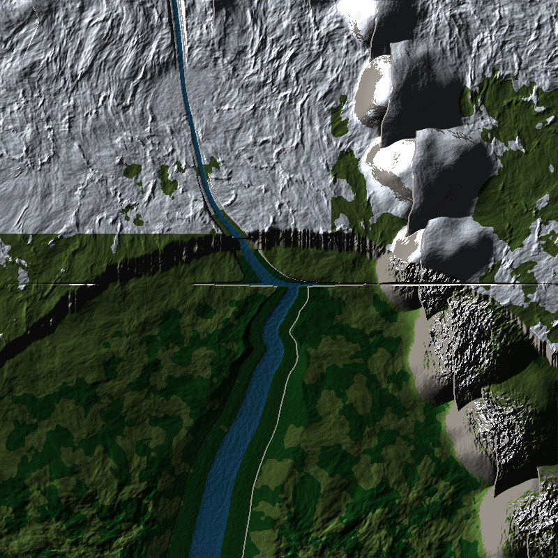

# AETHER · 程序化荒野 v2.2

**10.24 km² 纯程序化自然地形 · Godot 4.7.2 · 全部资产由数学离线/运行时生成**

西北雪原台地、中央约 207 m 瀑布与环形悬崖、南部热带雨林盆地，一条河从雪原穿过
悬崖、峡谷和雨林。v2.2 针对上一轮近景反馈重做了**岩面细节层**与**瀑布近景**：
新增 0.32 m 岩石细节贴图三件套、44×60 位移岩壁、1 m 岩面特写，以及 32 m 距离的
瀑布近景（竖向拉丝、断流孔洞、底部崩解与水雾）。


> 视频：`screenshots/water_flow.mp4` / `.gif`（沿河流向、几何波浪、礁石白沫）、
> `screenshots/waterfall.mp4`（32 m 近景：水幕下落、断流、底部水花）。

---

## 0. v2.3 瀑布近景（本轮修复）

本轮只做瀑布近景，但翻出两个把前几版结果全部带偏的硬 bug，务必保留这段记录：

1. **`shaders/waterfall.gdshader` 编译失败**：`vertex()` 里写了未声明的
   `strand_phase`，着色器编译不过，Godot 回落到默认材质 —— 所以"水幕"看起来
   是一层能透出崖壁的半透明帘幕。**任何"像玻璃"的水幕，先看控制台有没有
   着色器报错**，不要先怀疑参数。
2. **`water_builder.gd::_pool()` 把上游顶点水位 clamp 到溢流口**：水潭用圆盘
   生成，z < LIP_Z 的顶点走 `water_level()` 会取到崖顶水位（y≈500），于是
   水潭网格在瀑布后面折起一面 200 m 高的大板，横在水幕前。已限制
   `zz = max(zz, -201)`。**凡是横在水幕前的一大块平面，先查水面网格的 clamp。**

近景重做要点：

- 水幕 = **raymarch 水体**（`shaders/fall_volume.gdshader`，盒内 56 步、含
  自阴影）。密度来自相位扭曲的竖向水股（多条带 + 宽带两族，随深度错相，
  因此有体积与视差）+ 3D 噪声撕裂；上段致密水膜、中段撕成粗细不一的股并留
  空气孔洞、下段崩解成水雾落进潭里；边缘为低幅不规则扰动。
- 两个隐蔽坑：高度参数 `k`（溢流口→落点）曾用反，把水膜放在潭底、水雾放在
  顶上；边缘扰动幅度大于淡出宽度时会甩出游离的白色薄片（"花瓣"）。
- **崖壁层理按区域加权**（`terrain_pbr.gdshader` 的 `wf`）：按世界坐标到瀑布
  轴线（溢流口→落点）的距离做 `1-smoothstep(62,155,d)` 平滑权重。仅在
  `wf>0` 的峡谷内把岩壁交给世界空间数学（多尺度 fbm + 两条 `sin(h)` 沉积层理
  及其法线倾斜，`bed_relief`），并把瓦片法线压掉 90% 以消除斜向织纹；
  `wf=0` 的广域地形完全保持原参数，所以 river / hero_dusk 的远景崖壁不受影响。
  全局改层理试过两版（会变成"条纹遮阳篷"或"石膏墙"），已回退——**这类改动必须
  做区域权重，不要全局改**。
- 背景织纹的三个来源（已逐一去掉）：**Forest 远景叶卡铺满崖壁**（近瀑布
  96 m 清出无树峡谷）、**rock 层理贴图远处摩尔纹**（`terrain_pbr` 对 >34 m
  的细纹理层做均值淡出）、**DOF bokeh**（两张瀑布近景不用 CameraAttributes）。
- 曝光：太阳 3.6→2.2、环境 0.40、exposure 0.80；机位 40–50 m、高于水面
  11–15 m、仰角 9–11°、fov 60。
- 水潭：泡沫环改世界空间有机噪声（原极坐标 UV 本身就会织出网格）；水面波
  纹 UV 尺度放大；池面顶点波衰减（粗网格上会 alias 成格）。
- `assets/textures/water_normal.png` / `foam_mask.png` 已重新生成：去掉正弦
  条带与 Voronoi 胞元，只保留宽带带通噪声与扭曲脊线，否则大面积静水会
  "铺砖"。

## 1. v2.2 近景修复（对应本轮反馈）

### 1.1 岩面：不再只有横向涂抹

- 新增 4 张 **0.32 m 平铺**的岩石细节贴图：
  `rock_detail_albedo / normal / height / rough`。
  含 2–3 cm 矿物晶面、4–5 cm 嵌入卵石、1–3 cm 溶蚀坑、0.5–1.5 cm 发丝裂隙
  和 1 mm 颗粒。
- `rock_pbr.gdshader` / `terrain_pbr.gdshader` 叠加 **0.32 m 与 0.11 m 两级**
  细节层（scale 3.125 / 9.10），用 `fwidth` 做屏幕空间多级混合，
  2.2–4.8 m 距离衰减；三平面投影的 s 轴在三个平面上一致，无横竖拉伸比错误。
- 近景岩壁改为 **44×60 位移网格**：解析层理、层间掏蚀、垂直断层错位、竖向裂隙；
  顶点法线由位移场有限差分得到，不再是平面法线。`detail_rock` 的 0.4 m 层理
  与 1 cm 颗粒同时可见。
- 新增 `rock_1m.png`：镜头距岩面约 **1 m**，可辨认 1 cm 级晶面、坑洞与裂隙。

### 1.2 瀑布：32 m 近景，条带/孔洞/底部崩解

- 水幕改为 **3 层错位曲面**（不同宽度、深度、扰动），整体近垂直，底部向下游
  踢出后落入水潭。
- `waterfall_streaks.png` 重新生成为**不规则宽窄条纹 + 亮芯 + 暗缝**；
  片元用两级条纹采样、`TIME` 下行滚动、alpha 撕裂和边缘噪声，
  不再是光滑白带。
- 底边顶点按噪声撕开；底部 alpha 破碎并叠加 splash 粒子、soft spray 和
  水面撞击白沫（`water.gdshader` 的 impact 项）。
- `waterfall_20m.png` 机位距落水点约 **32 m**（20–40 m 验收区间内），
  画面中同时可见竖向拉丝、暗色断流孔洞、底部白色崩解和飞散水滴。
- `detail_waterfall.png` 为约 48 m 的中景，补充水幕全宽与落水潭关系。

### 1.3 水潭与岸线

- 水潭水面按河道纵剖面逐顶点取水位，不再是一整块高出河面的平板；
  落水点附近由 `water.gdshader` 的 impact 白沫项直接在水面上生成白水，
  而不是另铺一张白色圆盘。
- 瀑布落水点周围清出约 42 m 的**落水潭空场**（树冠/林木避让），
  保证 20–40 m 机位有干净视线，同时保留两侧崖壁和远处树冠。
- 岸线仍是湿沙 → 卵石 → 苔草渐变，近岸草/芦苇保留。

### 1.4 延续 v2.1 的修复

- 全屏交叉织纹定位为 `Environment.volumetric_fog` 的 froxel/时域抖动；
  v2.1 起关闭环境体积雾（保留距离雾、FogVolume、天空），v2.2 维持关闭。
- 叶片为羽状主脉 + 弧形侧脉，叶尖亮度/透光渐变；叶片网格有横向卷曲和厚度。
- 树冠高度差 9–31 m、幼/成熟色相分离；近岸草、芦苇与岸线过渡保留。

---

## 2. 三种地形

| 地貌 | 位置 | 高度 | 做法 |
| --- | --- | --- | --- |
| **雪原** | 西北 `-Z` 台地 | 500–700 m | 雪原掩膜 + 风蚀脊 + 雪线噪声；PBR 雪纹理 |
| **热带雨林** | 南侧盆地 `+Z` | 20–330 m | 暖湿掩膜 + 连续树冠 + 近景 3D 叶树 + 近岸草 |
| **山地悬崖 + 河谷** | 中央 `z≈-200` | 290–1050 m | 解析山墙 + 环形悬崖 + 207 m 瀑布 + 河道 |

雪线、雨林、悬崖、瀑布与河道拓扑与 v1/v2 一致，没有推倒重来。



---

## 3. 纯程序化管线

### 3.1 PBR 贴图（27 张，离线）

`tools/gen_textures.py`：FFT 带通噪声、周期 Voronoi、定向脊线、多尺度 fBm。

- rock / snow / ground / gravel：albedo + normal + roughness + height
- **rock_detail**：albedo + normal + height + rough（0.32 m 平铺，1 cm 级特征）
- bark / leaf：albedo + normal
- water_normal / foam_mask / waterfall_streaks

`terrain_pbr.gdshader` 做三平面投影、宏观/微观双尺度法线、近距离 POM、
湿沙/卵石/苔草岸线和水平层理。局部 0.2 m 网格补丁提供雪脊/碎石微位移。
岩壁与滚石共用 `rock_pbr.gdshader`，近处叠加 0.32 m / 0.11 m 岩石细节层。

### 3.2 3D 叶树

`hero_tree.gd`：递归树干/主枝/侧枝/支柱根 + 树皮 PBR；每棵树 **7005 片实心叶**
（正/背面、厚度、中脉、卷曲、AO、逆光、阴影）。近景 2 棵；广域森林用
canopy carpet + leaf-card LOD。

### 3.3 动态水

- 河面 UV 沿河道切线，顶点 3 组几何波浪；水法线/泡沫遮罩沿流向滚动。
- 3 块礁石的泪滴形白沫（上游短、下游长），岸边泡沫/涟漪。
- 瀑布 30×110 水幕 ×3 层，竖向拉丝/断流、底边撕裂、底部泡沫环、溅射、水雾。
- 落水潭水面按水位剖面生成，impact 白沫直接写入水面着色器。
- 视频：`water_flow` / `waterfall`。

### 3.4 性能

贴图离线；细节补丁/3D 叶树只在特写点（80–120 m 可见）；交互默认 768，
截图 1024；广域树/草 LOD。无物理碰撞。

---

## 4. 规模

| 项目 | 数值 |
| --- | --- |
| 地图 | 3.2 × 3.2 km = **10.24 km²** |
| 高度 | ≈14–1003 m |
| 瀑布 | ≈207 m |
| 地形 | 1024²，64 chunks，≈2.09 M tris |
| PBR 贴图 | 27 张程序化贴图（含 4 张岩石细节） |
| 近景岩壁 | 44×60 位移网格，解析层理/断层/裂隙 |
| 3D 叶树 | 2 棵 × 7005 片实心叶 |
| 广域树 / 草 / 蕨 / 芦苇 / 近岸草 | 9.0 k / 41 k / 9.5 k / 2.3 k / 2.3 k |
| 外部扫描资产 | 0 |

---

## 5. 运行

```bash
# 在本目录执行（脚本自行 cd 到工程根，随仓库迁移不影响）
./run.sh          # 交互，默认 768
./capture.sh      # 14 张 1600×900
./anim.sh         # 重渲两段视频
```

**操作**：WASD 平移，鼠标转向，Q/E 上下，Shift 加速，H HUD，Esc 释放鼠标；
`1` 黄昏，`2` 雪原边缘，`3` 雨林，`4` 峡谷，`5` 瀑布，`6` 雪原清晨，`7` 全景，
`8` 日间。

---

## 6. 截图（全部 1600×900，2026-11-16 20:58–20:59）

| 文件 | 内容 |
| --- | --- |
| `hero_dusk.png` | 黄昏逆光：雪原、瀑布、峡谷、雨林 |
| `snow_edge.png` | 雪原/雪蚀槽谷、雨林、海/云海 |
| `forest.png` | 雨林树冠、河流、悬崖 |
| `gorge.png` | 峡谷、瀑布、悬崖、雨林 |
| `river.png` | 沿河航拍 |
| `panorama.png` | 10.24 km² 全景 |
| `detail_rock.png` | 约 2.6 m 岩壁：层理、断层、1 cm 颗粒、POM |
| `rock_1m.png` | **约 1 m 岩面：1 cm 晶面、坑洞、裂隙** |
| `detail_snow.png` | 雪面 sastrugi、雪粒、露出岩石 |
| `detail_tree.png` | 3D 叶树、树皮、枝干 |
| `detail_leaf.png` | 1–2 m 叶片：羽状脉、卷曲、厚度、透光 |
| `detail_water.png` | 礁石、泪滴白沫、波浪、流向 |
| `detail_waterfall.png` | 约 48 m：水幕全宽、竖向拉丝、断流、底部水潭 |
| `waterfall_20m.png` | **约 32 m：条带、孔洞、底部崩解、水雾** |

视频：`water_flow.mp4` / `.gif`、`waterfall.mp4`（21:02）。

---

## 7. 文件结构（关键）

```
tools/gen_textures.py        PBR/岩石细节/水/泡沫/瀑布拉丝离线生成
assets/textures/             27 张程序化贴图
scripts/
  terrain_field/builder      高度场、河流、网格
  detail_scenes.gd           近景补丁、位移层理岩壁、礁石、泡沫
  hero_tree.gd               3D 叶树
  water_builder.gd           河面/三层瀑布/水位剖面水潭
  ground_cover.gd            草/蕨/芦苇/近岸草
  atmosphere.gd              水雾/溅射/落水潭喷雾
  texture_bank.gd            线性贴图加载
shaders/
  terrain_pbr.gdshader       三平面 PBR + POM + 岸线 + 岩石细节层
  rock_pbr.gdshader          岩壁 PBR + 0.32/0.11 m 细节层
  water.gdshader             流向/顶点波浪/礁石白沫/impact 白沫
  waterfall.gdshader         竖向拉丝/断流/底边撕裂/底部崩解
  hero_leaf.gdshader         羽状脉/卷曲/透光
  bark_pbr / canopy / sky / foam / splash ...
```

---

## 8. 已知边界

- 广域森林仍是 canopy/card LOD；7005 片实心叶的 3D 树只在特写点。
  瀑布 20 m 镜头周围的树冠做了 42 m 空场，宽景里会看到这块林窗。
- 悬崖主体是高度场陡坡 + 参数化岩块；`detail_rock` 的近景层理岩壁是
  44×60 位移网格，不是整条悬崖的统一几何，也不是扫描资产。
- 水/瀑布是顶点波浪 + 法线/泡沫/粒子 + 多层水幕的实时近似，不是流体模拟；
  水幕的条带与孔洞来自程序化遮罩和 alpha 撕裂，不是体积流体。
- 雪原边缘保留风蚀斑块；地图外的海/云海是天空与远景背景。
- 没有物理碰撞，相机自由飞行。