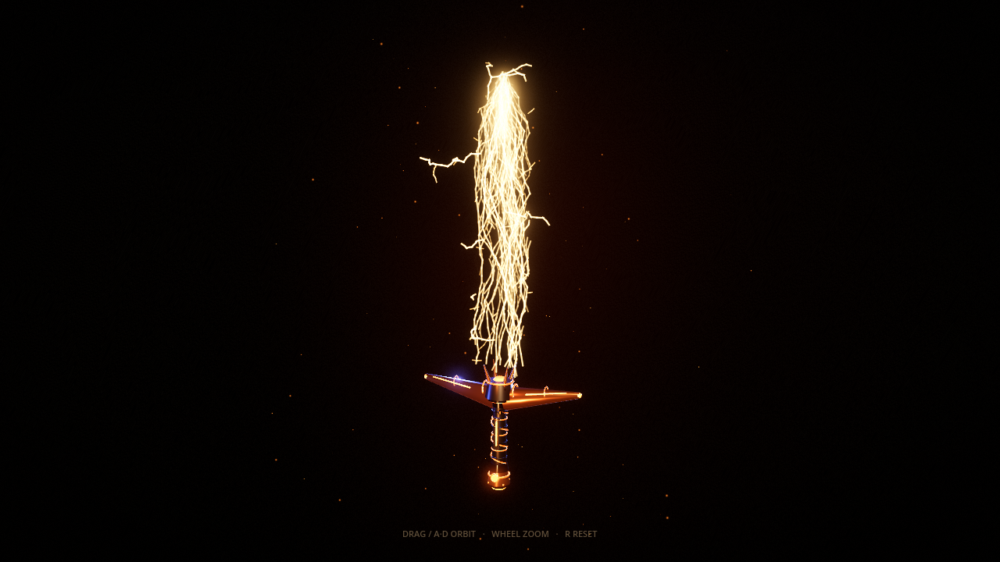
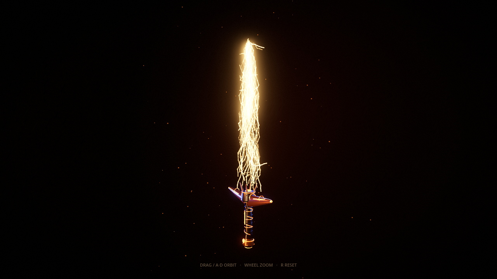

# Voltaic Edge

一把 **3D 黄金电弧剑**。剑刃完全由程序化生成的电弧构成；握柄不是电弧，而是一套实体的 **Arc Generator（电弧发生器）**。

Godot 版本：**4.7.2（Forward+）**。项目无外部美术资源，所有几何、材质、发光和粒子均在运行时生成。





*60° 视角：可以看到剑刃真实厚度、护手深度，以及同时出现的多根逃逸电弧——小的多、大的少，大尺寸会递归分叉。*

## 运行

```bash
godot --path . --resolution 1280x720
```

也可以直接用 Godot 打开 `project.godot` 后按 F5。

## 操作

- **左键拖拽**：360° 环绕观察
- **滚轮**：拉近 / 拉远
- **A / D** 或 **← / →**：左右环绕（可一直转到背面）
- **W / S** 或 **↑ / ↓**：抬高 / 降低视角
- **R**：重置相机
- **拖拽时**：电弧与发生器会略微增亮

界面底部的提示会自动淡入淡出。

## 视觉结构

### 剑刃：实时随机先导（leader）模型

剑刃不是把采样点连起来，也不是发光贴图。`src/arc_field.gd` 现在是一个受闪电先导/分形击穿文献启发的实时随机先导模型：

- **剑形体积**：柔和的 3D 剑刃密度场，x 方向近似直刃，z 方向有真实厚度（基部约 0.22 world units），末端收尖；边界是统计性的软边界。
- **多条先导**：从发生器根部、剑刃内部 corona 点、随机侧缘点和尖端附近发射多条 leader。
- **曲折步进**：每一步方向 = 上一步方向惯性 + 随机噪声 + 尖端电场吸引；转角受限，形成自然的 tortuous path。边界内才继续，越界时向尖端/内部修正或终止。
- **递归分叉**：每个 leader 在每一步以随机概率分叉；概率随通道电荷与局部场增强。分叉方向从父方向偏转 20–55°，子通道递归生长 3–4 代。
- **电荷/粗细分配**：父通道把电荷分给子通道；线宽和能量按 `charge^0.65` 下降，所以主通道粗亮、末梢细暗，而不是一整团同宽线。
- **逃逸树杈**：同一套递归 leader 模型，但取消剑刃体约束。每 25 ms 生成 3–6 个独立逃逸电弧，寿命仅 60–135 ms；**instant 模式：出现即全亮，寿命到直接消失，不淡入淡出**。尺寸服从指数分布 `s = -ln(1-u) · 0.26`：多数是 1–4 步的小电弧刺，偶尔出现 8–14 步的大分叉树。因此会同时有很多根，小的多、大的少，大的会递归分叉。逃逸树的步长统一乘了 `ESCAPE_SPATIAL_SCALE = 0.5`，整体空间尺度再减半。
- 剑刃自身没有固定的中心主弧或左右刃缘硬线；所有路径都是每次重新随机的。

参数与入口：

- `src/arc_field.gd` 的 `_grow_leader()`：leader 步进、分支、电荷分配、边界修正。
- `grow()`：主 leader、corona、侧缘、尖端。
- `grow_escape_one()`：生成一个无约束逃逸电弧；尺寸指数分布，大小决定步数、电荷与分叉概率。
- `src/arc_sword.gd`：20ms 生成、140ms 生命、局部 bolt 叠加。

### 剑柄：实体电弧发生器

`src/generator_hilt.gd` 在运行时搭出一个实体装置：

- 深色金属握柄与青铜护手
- 金色能量环、前部能量槽、拇指开关
- 环绕握柄的金色螺旋线圈
- 尾端能量电池与正面发光电池窗
- 带四爪的发射器，剑刃从发射口上方产生
- 冷蓝边缘光 + 暖色主光，让金属在暗背景中有体积感

它不是由电弧组成的剑柄，而是产生剑刃的装置。

## 关于闪光与三角片

之前有两个独立问题：

1. **三角片状爆亮**
   ribbon 四个顶点中，A 端把“另一个端点”当作方向，B 端方向相反，四边形会扭成蝴蝶结；某些角度下会张开成一大片三角形。
   现在在顶点着色器里用 `UV.x` 统一了屏幕方向，A/B 两端始终使用同一个 `dir`，四边形不会再扭转。

2. **整体的高频频闪**
   原先每 20–30 ms 整棵树瞬间重生并快速衰减，会造成 50 Hz 的亮度/结构频闪，正对剑面时尤其明显。
   现在改为：
   - 20 ms 生成一小片局部先导森林（不是整棵剑）
   - 140 ms 生命周期 + 交叉淡入淡出，约 7 片重叠
   - 新生成的电流片从 `fade = 0` 开始；之前它在添加当帧仍以全亮渲染一帧，这正是每个 spawn 一帧爆闪的来源
   - 每片总能量归一化
   - 去掉全局尖锐脉冲和高频 shimmer
   - 剑刃本体不再每个 spawn 全亮闪一帧
   - 逃逸电弧故意使用 instant：出现即全亮、寿命结束直接消失，不做慢速淡入淡出；这是用户要求的“电弧式”跳变，不再是一个 0.7 s 的大树慢慢生长

正向剑面时不再出现“每个剑刃 bolt 一帧全亮”的爆闪；逃逸电弧的短暂爆闪是有意保留的放电跳变。

## 建模依据

生成器参考了以下闪电先导 / 分形击穿 / streamer 分支文献：

- L. Niemeyer, L. Pietronero, H. J. Wiesmann, *Fractal Dimension of Dielectric Breakdown*, Phys. Rev. Lett. 52, 1033 (1984). DOI: 10.1103/PhysRevLett.52.1033 — DBM / 分形击穿的分支与电场加权思想。
- *On the development of a lightning leader model for tortuous or branched channels — Part I / II*, J. Electrostatics 66 (2008). DOI: 10.1016/j.elstat.2008.04.012 / 10.1016/j.elstat.2008.04.011 — 曲折与分叉先导的统计建模。
- *A stepped leader model for lightning including charge distribution in branched channels*, J. Appl. Phys. 116 (2014). DOI: 10.1063/1.4895155 — 分支通道的电荷分布、分形特征、随机传播。
- *Numerical Simulation of Stepping and Branching Processes in Negative Lightning Leaders*, JGR Atmospheres (2020). DOI: 10.1029/2019JD031360 — stepping、branching、streamer zone / space stem 触发分支。
- *Dynamics of branching of negative downward lightning leaders*, Appl. Phys. Lett. (2017). DOI: 10.1063/1.5010714 — 负先导分支动力学。
- Z. Wang et al., *Quantitative modeling of streamer discharge branching in air*, Plasma Sources Sci. Technol. (2023). DOI: 10.1088/1361-6595/ace9fa — 光致电离随机噪声触发 streamer 分叉。
- F. Vera, *The tortuous behavior of lightning*, arXiv:nlin/0206011 — 闪电通道曲折性与边界条件/能量。
- *Lightning optimizes: a threshold mechanism ensures minimum-path flow*, Sci. Rep. (2020). DOI: 10.1038/s41598-020-79463-z — 多分支先导的竞争与最终主通道。

本实现是面向实时渲染的随机先导模型，不是完整 3D 等离子体/Laplace 求解：它保留了文献中最影响观感的结构——曲折传播、随机递归分叉、电荷/粗细分配、场驱动增长和边界条件。

## 可调参数

- 剑刃轮廓与厚度：`src/arc_field.gd` 顶部的 `TIP_Y`、`BASE_Y`、`BLADE_BASE_HALF_X/Z`、`BLADE_TIP_WIDTH_START`
- 电弧密度 / 频闪：`src/arc_sword.gd` 的 `SPAWN_INTERVAL`、`BOLT_LIFE`、`PARTIAL_SCALE`、强度系数
- 逃逸树杈：`src/arc_field.gd` 的 `grow_escape_one()` / `_grow_leader()` 与 `src/arc_sword.gd` 的 `ESCAPE_*` 常量
- 先导行为：`MAX_GENERATION`、`_grow_leader()` 的惯性/噪声/场权重、分支概率、电荷分配
- 逃逸树杈：`src/arc_sword.gd` 的 `ESCAPE_WAVE_INTERVAL`、`ESCAPE_LIFE_MIN/MAX`，以及 `src/arc_field.gd` 的 `ESCAPE_SPATIAL_SCALE`、指数尺寸、步数与分叉概率
- 金属 / 线圈 / 发生器外观：`src/generator_hilt.gd`
- Bloom / 色调：`src/main.gd` 的 `_setup_environment()`

## 调试截图

项目内置了一个离线截图入口：

```bash
godot --path . --resolution 1280x720 -- \
  --capture /tmp/shot.png --capture-delay 2.0
```

连续帧：

```bash
godot --path . --resolution 960x540 -- \
  --capture /tmp/burst.png --capture-delay 1.5 --capture-count 8
```

它会输出 `burst000.png`、`burst001.png` 等，便于检查运动过程中的闪烁和几何异常。

注意：连续 `get_image()` 截图会阻塞主线程；如果每帧都截图，20ms 生成可能追不上，画面会显得变暗/变慢。这是截图调试模式的影响，不是正常运行状态。

固定角度检查（用于观察厚度）：

```bash
godot --path . --resolution 1280x720 -- --view-yaw 60 --capture /tmp/orbit.png --capture-delay 2.0
```
